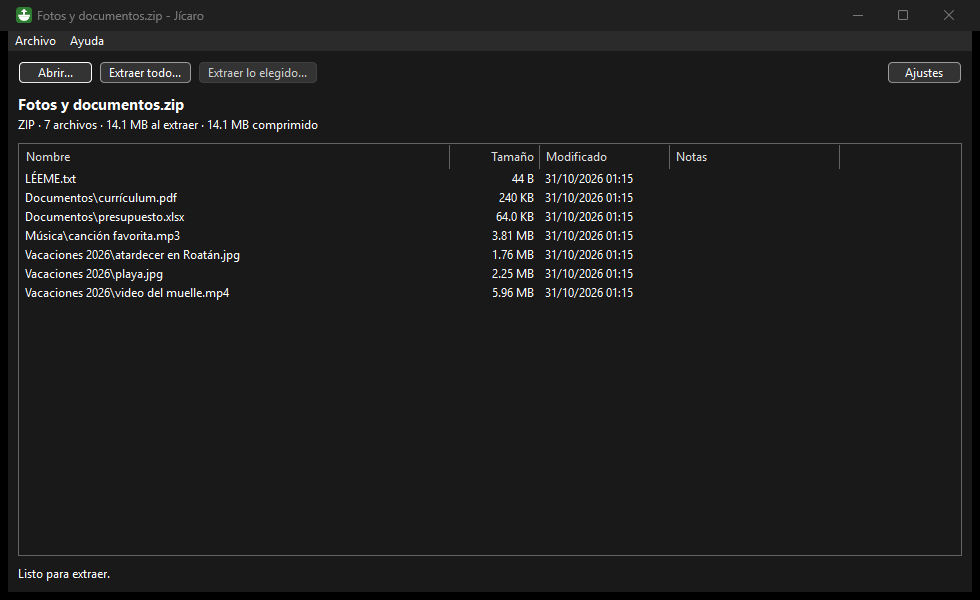

# Jícaro

**Descompresor gratis para Windows 10 y 11.** Abre y extrae ZIP, RAR, 7z, ISO y muchos más, también los RAR
cortados en varias partes que bajas de internet. Sin publicidad, sin virus y sin recoger tus datos.

El jícaro es el árbol hondureño cuyo fruto, seco, sirve de vasija. Hecho por [Brizna Soft](https://brizna-soft.github.io)
en Honduras.



## Descargar

**[Baja la última versión](https://github.com/Brizna-Soft/jicaro/releases/latest)**: el archivo `Jicaro-x.y.z-x64.zip`.

1. Descomprime el .zip en una carpeta, por ejemplo `Documentos\Jícaro`.
2. Abre `Jicaro.exe`. No hace falta instalar nada.

> **¿Windows dice «Windows protegió su PC»?** Sale porque el programa es nuevo y todavía no tiene firma
> digital, que cuesta dinero. Pulsa **Más información** y luego **Ejecutar de todas formas**.
>
> Si quieres comprobar que el archivo es el original, compara su huella SHA-256 con el archivo `.sha256` de la
> misma página. Los .zip los arma GitHub a partir de este mismo código.

## Qué hace

- **Abre:** ZIP (también con contraseña: ZipCrypto y AES), RAR 4, RAR 5, 7z, TAR, GZ, BZ2, XZ, ZST, ISO y CAB.
  También los `.tar.gz`, `.tar.xz`, `.tar.zst` y parecidos, y los archivos sueltos como `notas.txt.gz`.
- **RAR en varias partes.** Abre cualquier parte (`juego.part03.rar`) y Jícaro junta el juego completo, desde la
  primera. Sirve con el estilo nuevo (`.part01.rar`, `.part02.rar`...) y con el viejo (`.rar`, `.r00`, `.r01`...).
  También los archivos cortados en trozos `.7z.001`, `.7z.002`... **Si falta una parte, te dice cuál.**
- **Ver antes de extraer:** arrastra el archivo a la ventana (o pulsa **Abrir...**) y ves lo que trae, con su tamaño
  y su fecha. Puedes extraer todo o solo lo que elijas, con progreso y un botón para cancelar.
- **Clic derecho:** si lo activas en **Ajustes**, aparecen «Extraer aquí» y «Extraer en una carpeta con su nombre».
  En Windows 11 están en **Mostrar más opciones**.
- **Si un archivo ya existe,** pregunta: reemplazar (lo que ya estaba va a la **Papelera**), guardar los dos o
  saltarlo. Se puede dejar elegido en Ajustes.

## Lo que no hace

- **No abre los RAR ni los 7z con contraseña.** La biblioteca que usa (libarchive) todavía no lo permite, y Jícaro
  te lo dice claro. Para esos usa 7-Zip o WinRAR. Los ZIP con contraseña sí se abren.
- **No crea archivos RAR** (ni otros comprimidos): solo extrae. Jícaro no trae código de 7-Zip ni de unRAR.
- El nombre de la opción del clic derecho es fijo («Extraer en una carpeta con su nombre»): para que muestre el nombre
  de cada archivo haría falta un componente de Windows aparte, que esta versión no trae. Tampoco sale en el menú nuevo
  de Windows 11, solo en «Mostrar más opciones».

## Cuida tu seguridad

Los archivos comprimidos pueden venir con trampas. Jícaro las frena:

- **Nada sale de la carpeta de destino.** Se saltan las rutas con `..`, las rutas completas (`C:\...`, `\...`,
  `\\servidor\...`) y los nombres que Windows trataría como otra cosa (`CON`, `NUL`, `archivo:flujo`...). Jícaro hace
  su propia revisión además de usar las protecciones de libarchive: en las pruebas, libarchive sola dejaba pasar una
  ruta como `\Users\...\archivo.txt`.
- **No crea enlaces.** Los enlaces simbólicos y los enlaces duros que traiga el archivo no se crean, y no escribe a
  través de un enlace o una unión que ya estuviera en la carpeta: revisa todo el camino antes de escribir cada archivo.
  Un enlace duro a otro archivo del mismo comprimido se guarda como copia.
- **Bombas de descompresión** (archivos chiquitos hechos para llenar el disco): pregunta antes de seguir si lo
  extraído pasa de 512 MB y de 100 veces lo que pesa el comprimido, si ya ocupa más de la mitad del espacio libre que
  había o si trae más de 200,000 archivos. Cuando el archivo anuncia el tamaño, pregunta antes de crearlo; también
  cuentan los archivos «con huecos» y las copias de enlaces duros. Se detiene solo si el disco queda con menos de
  512 MB libres. Lo que quede a medias al detenerse se quita, pero solo si es el mismo archivo que creó Jícaro (lo
  comprueba con el identificador que le da Windows).
- **Marca de la Web.** Si el archivo comprimido se bajó de internet, lo que extraes queda marcado igual, como hace
  Windows con sus propios ZIP. Así Windows y tu antivirus siguen avisando antes de abrir programas que vienen de
  internet. Se hace como indica Microsoft: los programas y scripts pasan por los servicios de adjuntos de Windows
  (`IAttachmentExecute`, con el comprimido como origen), que además avisan al antivirus; lo demás recibe la misma
  marca con `IZoneIdentifier`.
- **Nunca reemplaza el archivo que está leyendo**, aunque la entrada use su nombre corto (como `JUEGO~1.RAR`), ni
  borra nada sin preguntar: lo que se reemplaza va a la Papelera.
- **«Extraer en una carpeta con su nombre»** no reutiliza un enlace o una unión que ya tenga ese nombre: en ese caso
  usa otro, como `juego (2)`.

## Privacidad

- Jícaro no tiene publicidad, no manda estadísticas y no se conecta a internet. Solo lo hace cuando pulsas
  **Ayuda → Buscar actualización**, que pregunta a GitHub por la versión más nueva.
- No pide ser administrador y no cambia la configuración de Windows. El clic derecho solo se escribe en tu cuenta
  (`HKEY_CURRENT_USER\Software\Classes`) cuando marcas la casilla, y se quita al desmarcarla.
  **Antes de borrar Jícaro, desmarca esa casilla.**
- Tus ajustes están en `%LOCALAPPDATA%\Jicaro`. El registro de fallas (`registro.txt`) no guarda nombres de archivos.

## Para otros programas (por ejemplo Atarraya)

```
Jicaro.exe --extraer "<archivo>" [--destino "<carpeta>" | --aqui] [--si-existe preguntar|reemplazar|saltar|renombrar]
```

- Sin `--destino` ni `--aqui`, extrae en una carpeta nueva con el nombre del archivo, al lado de él.
- Muestra una ventana chica de progreso. Si todo sale bien se cierra sola; si algo falla, se queda con el resumen.
- Si se le pasa cualquier parte de un RAR en varias partes, extrae el juego completo. Si se abren varias ventanas
  para el mismo juego (por ejemplo, al elegir todas las partes y pulsar «Extraer aquí»), solo una extrae.
- Sin `--si-existe`, usa lo que la persona eligió en Ajustes.

Códigos de salida: `0` bien · `1` error · `2` cancelado · `3` falta una parte · `4` contraseña o cifrado que no se
puede abrir · `5` otra ventana de Jícaro ya está extrayendo ese archivo · `6` salió solo una parte (algo se saltó
por seguridad o no se pudo extraer).

También: `Jicaro.exe --registrar-menu` y `Jicaro.exe --quitar-menu` ponen y quitan el clic derecho.

## ¿Algo falla?

[Reporta el problema aquí](https://github.com/Brizna-Soft/jicaro/issues/new/choose): cuéntanos qué pasó y qué tipo de
archivo era. Si puedes, pega el contenido de `%LOCALAPPDATA%\Jicaro\registro.txt`.

## Apoyar

Jícaro es y seguirá siendo gratis. Si te sirve, puedes apoyar a Brizna Soft con una
[donación por PayPal](https://paypal.me/BriznaSoft) o simplemente recomendarlo.

## Compilar desde el código

Necesitas Visual Studio 2022 (o sus Build Tools) con C++ y Git. Luego:

```
powershell -ExecutionPolicy Bypass -File compilar.ps1
powershell -ExecutionPolicy Bypass -File pruebas\probar.ps1
```

La primera vez baja vcpkg y compila wxWidgets y libarchive (con zlib, bzip2, liblzma y zstd). El programa queda en
`programa\`. Las pruebas usan archivos de la suite de pruebas de libarchive (licencia BSD) y otros que arman ellas
mismas, entre ellos archivos con trampas y una bomba chica.

## Licencia y créditos

- Código de Jícaro: licencia MIT, © 2026 Brizna Soft. Hecho con ayuda de IA.
- Bibliotecas de código abierto que usa, con su licencia:
  - [libarchive](https://www.libarchive.org): BSD de 2 cláusulas (con partes bajo BSD de UC Regents, dominio público
    y CC0/OpenSSL/Apache 2.0, según su archivo COPYING).
  - [wxWidgets](https://www.wxwidgets.org): wxWindows Library Licence 3.1.
  - [zlib](https://zlib.net): licencia zlib. [bzip2](https://sourceware.org/bzip2/): licencia de bzip2.
    [XZ Utils / liblzma](https://tukaani.org/xz/): 0BSD. [Zstandard](https://github.com/facebook/zstd): BSD.
  - [nlohmann/json](https://github.com/nlohmann/json): MIT.

  Los textos completos de esas licencias, y los de otras bibliotecas que trae la compilación, están en
  `AVISOS-DE-TERCEROS.txt`. Nombrarlas aquí no significa que sus autores respalden Jícaro.
- «7-Zip», «WinRAR» y «RAR» se nombran solo para explicar con qué archivos trabaja Jícaro; no tiene relación con sus
  autores.
